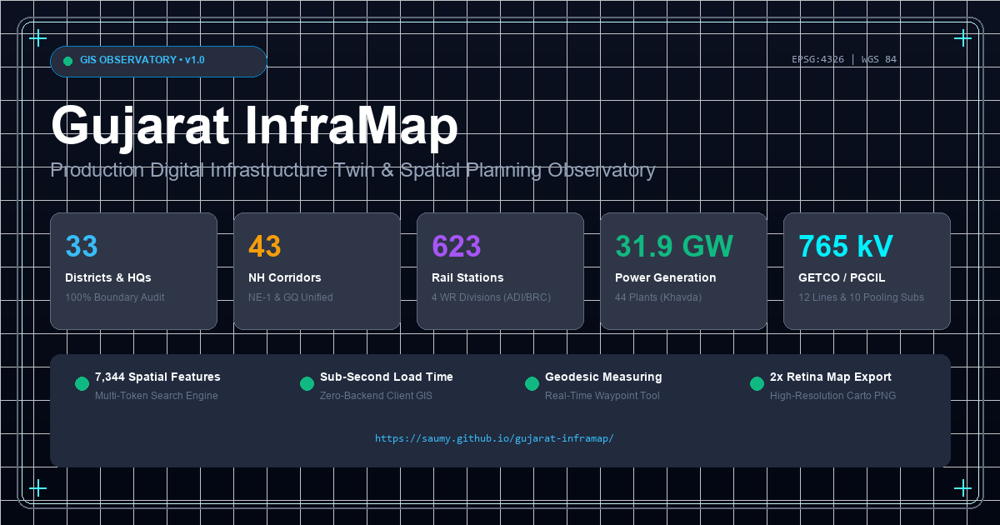

# Gujarat InfraMap 🗺️⚡

> **Production Digital Infrastructure Twin & GIS Spatial Planning Observatory for Gujarat, India.**



[](#deployment--hosting)
[](.github/workflows/deploy.yml)
[](#performance-benchmarks)
[](#tech-stack)
[](LICENSE)

---

## 📌 Executive Overview

**Gujarat InfraMap** is a client-side geospatial web application designed for civil and electrical engineers, spatial analysts, urban planners, and researchers. It aggregates scattered multi-modal infrastructure across Gujarat into a single, high-performance, dark-themed GIS spatial observatory.

- **Zero-Backend Client GIS:** Powered entirely by Leaflet.js, vanilla JavaScript (ES6+), and client caching. Requires no database servers or proprietary GIS engines.
- **Authoritative Data Coverage:** 13 comprehensive geospatial infrastructure & geoenvironmental layers covering 33 districts, 43 national highway corridors (8,940+ km), 31 signature civil structures (18 bridges, 5 flyovers, 2 tunnels, 6 multimodal freight terminals/ICDs), 623 passenger railway stations across 2,264 Western Railway tracks, 49 verified power generation facilities (33.7 GW total capacity including 14 hydropower generating stations aggregating 1,813 MW), 37 GETCO/PGCIL 765kV/400kV/220kV transmission corridors and grid pooling substations, 90 verified water topological assets (30 CWC dams aggregating 23,646 MCM capacity, 8 major river trunks, 8 canal networks, 7 CWC gauge stations, 4 municipal WTPs, 2 bulk lift pumping stations, 6 culturable command footprints, and 8 regional river basins) with graph-based 'Follow the Water' tracing, 41 authoritative geoenvironmental features (7 bedrock lithological formations per GSI Bhukosh, 5 active seismogenic faults per ISR/GSI, 5 soil series per NBSS&LUP with expansive Vertisol swell mechanics, 5 SRTM DEM terrain regimes, 10 CGWB hydrograph monitoring stations, 3 coastal hazard sectors per NCSCM/SAC, and 6 Ramsar / ecological reserves per MoEFCC), 33 CGWB aquifer extraction profiles, 8 major commercial seaports (640+ MMT), 7 commercial airports, 9 mega SEZs / GIDC hubs, Ahmedabad Metro lines, BIS IS 1893 seismic zones, IMD cyclone hazard zones, and 6 wildlife sanctuaries.
- **Production Performance:** Sub-second cold load time, zero-jank 60 FPS panning, hardware GPU-composited opacity controls, 8 curated intelligence presets, and WCAG 2.1 AA accessibility.

---

## 🚀 Key Features

| Capability | Description |
| :--- | :--- |
| **Modular Layer Manager & Scale-Dependent Engine** | Modular, 11-category GIS layer management suite organizing 28 infrastructure & environmental layers. Features group-level master visibility toggles, individual layer switches with asset metrics and minimum zoom badges (`z6+`, `z7.5+`, `z8+`), dedicated GPU-composited opacity sliders per layer, instant live keyword search across 27 layers with auto-accordion expansion, one-click calibrated baseline reset, real-time floating Active-Layer Legend with cartographic swatches and scale visibility indicators (`● Visible` vs `○ Zoom in`), and multi-tier Level-of-Detail (LOD) rendering preventing visual clutter from state level down to street level, backed by an isolated pulsating selection halo. |
| **Civil Science Stop Framework** | Universal, field-based educational civil engineering laboratory embedded across every asset category in the Gujarat Digital Twin. Delivers 5 category-tailored educational pillars grounded in Indian Standards (IS / IRC / CWC / CEA / CPHEEO): (1) *What it is* (structural definition, purpose, and engineering role), (2) *How it works* (mechanism, load paths, labeled vector SVG schematics, and theory), (3) *Engineering calculations* (interactive parametric formula calculators with live sliders, consistent units, step-by-step mathematical substitution strings, physical limitations, and statutory IS/IRC references), (4) *Gujarat context* (actual geographic setting, connected networks, environmental setting, and documented regional role), and (5) *Interesting facts* (curated, verifiable civil engineering milestones). Covers 10 tailored domain models (Dams, Bridges, Roads, Railways, WTPs, STPs, Substations, Renewables, Geotechnical Foundations, Coastal Breakwaters) plus universal fallback. |
| **Water Scenarios Lab** | Full-screen 3-mode interactive educational hydro-environmental laboratory: (1) Scenario A — Reservoir Storage Mass-Balance ($\Delta S = V_{\text{in}} - V_{\text{out}} - V_{\text{evap}} - V_{\text{seep}}$) with calibrated hypsometric Elevation-Area-Capacity (EAC) stage estimation, physically bounded storage tiers, and emergency spillway surcharge modeling across 8 benchmark reservoirs with dated CWC observations, (2) Scenario B — Heavy Rainfall & Catchment Flood Exploration utilizing SCS Curve Number (CN) direct runoff depth, triangular unit hydrograph peak discharge, and Manning's 1D uniform channel stage across 5 documented basins with historical flood benchmarks (including 1979 Machhu disaster and 2006 Surat flood), and (3) Scenario C — Regional Drought & Water Availability Stress tracking annual replenishment shortfalls, multi-sector rationing (Agriculture 75%, Domestic 15% Priority #1, Industrial 10%), groundwater overdraft buffers, and day-of-zero live storage timelines. Features before-vs-after visualizers, perturbation sensitivity matrices, JSON config save/import, technical memo export, and statutory operational disclaimers (`S` shortcut). |
| **Gujarat Geoenvironmental Intelligence** | Full-screen 4-tab geotechnical, geological, hydrological, and hazard screening suite: (1) Dataset Provenance & Reliability Ledger documenting all 11 scientific datasets (resolution, publication date, source agency, license, limitations, CSV export), (2) Thematic Overlays & Legends with 1-click Leaflet map toggles across Bedrock Geology, Soils & Expansive Clay, SRTM Terrain & Slope, CGWB Groundwater, BIS IS 1893:2016 Seismic Faults, Coastal Inundation & Salinity, and Ramsar Ecology, (3) Asset & Location Context Profiler cross-referencing civil structures (dams, bridges, roads, districts) against underlying lithology, swell pressure, seismic zone, groundwater extraction, and engineering relevance mechanisms (slope for embankment stability, soil permeability for seepage/piping, groundwater for uplift/chemical corrosion, seismic for liquefaction & ductility) with prominent statutory non-inference disclaimers, and (4) Project Site & Alignment Screening Tool enabling lat/lon or 1-click crosshair map placement to generate automated Pre-Feasibility Screening Memorandums with IS 1892 recommended investigation programs, clipboard copy, and Markdown export (`G` shortcut). |
| **Administrative Boundaries** | 33 administrative districts and 33 district headquarters with official Census & AMC area metrics. |
| **Transportation & Civil Structures Explorer** | Full-screen 4-tab multi-modal engineering engine & transport observatory: (1) Infrastructure Inventory & Ledger with multi-filtering across 43 highway corridors, 31 signature civil structures, railway stations, ports, and airports, with dynamic KPIs and CSV export, (2) Signature Bridges & Structures Showcase with comparative engineering cards (Sudarshan Setu, New Narmada Extradosed, Golden Bridge, Surat Cable-Stayed, Atal Pedestrian Bridge, SG Highway Elevated, KKV Overpass, MAHSR Bullet Train Bridges) and statutory inspection disclosures, (3) Multi-Modal Freight & Corridor Networks deep-diving into Western Dedicated Freight Corridor (WDFC) vs Golden Quadrilateral (NH-48), port-rail hinterland evacuation matrices, and High-Speed Rail (MAHSR), and (4) Transport Civil Engineering Lab featuring interactive calculators for Stopping Sight Distance (SSD) & Superelevation under IRC:73, Lacey's Bridge Pier Regime Scour Depth under IRC:5/78, and Pavement Structural Anatomy (Flexible Asphalt vs Rigid Concrete) (`T` shortcut). Features interactive map-to-map relationship highlighting linking bridges to supporting routes and crossed features. |
| **Unified Highway Corridors** | 43 consolidated national highway corridors (NE-1, NH-48 Golden Quadrilateral, arterial trunks) with official NHAI speed limits (NE-1 120 km/h) and scale-dependent LOD rendering. |
| **Railway Network & Stations** | Complete Western Railway broad gauge tracks (2,264 lines) and 623 clickable passenger railway stations across ADI, BRC, RJT, and BVC operating divisions. |
| **Power Grid & Transmission** | 49 verified generation facilities (Solar, Wind, Thermal, Nuclear, Hydro, Gas) with installed capacities up to 4,620 MW (Mundra) and Khavda RE Park (30 GW), plus GETCO/PGCIL 765kV/400kV lines and 22 grid pooling substations. |
| **Hydropower & Energy Explorer** | Full-screen 4-tab energy analytics engine and Water–Energy Nexus observatory: (1) Generating Stations Ledger with multi-filter toolbar, capacity tiers, dynamic KPI strip, and CSV export, (2) Water–Energy Nexus View mapping hydro generation, thermal/nuclear cooling intakes (Wanakbori, Ukai, Kakrapar, Mundra), and bulk irrigation pumping loads (Dhanki 120 MW, Navda 45 MW), (3) Audited Capacity vs Generation Benchmark comparing installed MW against CEA FY 2023-24 audited MU with statutory metric disclosures and PLF/CUF percentage benchmarks, and (4) Hydropower Engineering & Conversion Lab with interactive parametric calculator ($P = \rho g Q H \eta$), turbine selection logic (Pelton, Francis, Kaplan), and seasonal monsoon hydrology cycle (`H` shortcut). Features real-time grid evacuation tracer on map. |
| **Water Resources & Dams Explorer** | 90 verified water assets across 8 regional river basins: 30 dams (Sardar Sarovar 9,460 MCM, Ukai 7,414 MCM, Kadana 1,542 MCM, Dharoi 867 MCM), 2 barrages (Vasna, Wanakbori), 2 weirs (Kakrapar, Singanpur), check dam networks, 6 reservoir water spreads, 8 major trunk rivers (Banas, Shetrunji, Bhadar, Machhu, Damanganga, Karjan, Watrak, Hathmati), 8 canal networks (Narmada Main Canal, Kutch Branch Canal, Saurashtra Branch, Fatehwadi, Mahi Right Bank, Kakrapar, Ukai, Dharoi, Dantiwada, Shetrunji), 7 CWC gauge stations, 4 municipal WTPs, 2 bulk lift pumping stations, and 6 culturable command footprints aggregating 23,646 MCM gross capacity. Includes full-screen Dams Explorer modal with sortable ledger, multi-filter toolbar, dynamic KPI strip, and CSV export (`W` shortcut). |
| **Gujarat Water Systems Network & 'Follow the Water'** | Directed topological graph network modeling real-world hydraulic connectivity: Dam $\to$ Reservoir, River $\to$ Upstream/Downstream trunks, Reservoir $\to$ Outlets $\to$ Canals $\to$ Pumping $\to$ Distributaries, and Water Sources $\to$ Treatment Plants $\to$ Command Areas. Features interactive 'Follow the Water' step-by-step navigation mode with floating HUD, animated flow vectors, bifurcation branch choice chips, 8 regional river basin summary cards with coverage transparency qualifications, and disconnected network audit ledger (`N` to toggle Explorer, `F` to launch trace). |
| **Dam Science Lab** | Parametric civil & hydraulic engineering suite attached to every dam asset: Section A (structural materials, foundation geology, labeled vector cross-section schematics), Section B (interactive calculators for hydrostatic pressure $p = \rho gh$, resultant thrust $F = \frac{1}{2}\rho gbH^2$, hydroelectric power $P = \rho gQH\eta$, and flow/volume converters), Section C (gross/live/dead storage zones, FRL/MWL/MDDL elevations, interactive hypsometric EAC bathymetric curve), Section D (uplift, piping, foundation mechanics, slope stability, siltation, flood routing, geotechnical instrumentation), and Section E (regional supply footprint, comparative benchmarking, distinctive engineering profiles) (`L` shortcut). |
| **Reservoir Flood Simulator** | Interactive water balance calculator computing volumetric change ($\Delta S$) and projected reservoir stage change ($\Delta H$) from inflow, outflow, and duration inputs. |
| **CGWB Groundwater Profiler** | Official Central Ground Water Board (Ministry of Jal Shakti) aquifer extraction assessments across all 33 Gujarat districts (Over-Exploited, Critical, Safe, Saline ingress). |
| **Ports, Airports & Mega SEZs** | 8 commercial seaports (Mundra APSEZ 260 MMT, Deendayal 137 MMT, Dahej, Hazira), 7 commercial airports (SVPIA AMD, Surat, Vadodara, Rajkot HSR), 9 mega industrial parks (Dahej PCPIR, Dholera SIR, Sanand GIDC, GIFT City), and Ahmedabad Metro Phase 1. |
| **Disaster Hazards & Ecology** | BIS IS 1893:2016 Seismic Zones (Zone V Kutch Z=0.36, Zone IV Z=0.24, Zone III Z=0.16), IMD 50 m/s Cyclone Wind Risk, 4 River Floodplains, and 6 protected wildlife reserves (Gir Lion Sanctuary, Marine National Park). |
| **Multi-Modal Site Proximity Audit** | Interactive site analyzer calculating geodesic distance to nearest highway, railway station, power plant, dam, seaport, and airport with accessibility index scoring (`P` shortcut). |
| **Multi-Token Search Engine** | Sub-millisecond client-side spatial search across all indexed infrastructure features with domain intent boosts and keyboard navigation (`/`, `Arrow`, `Enter`). |
| **Geodesic Measurement Tool** | Interactive geodesic distance calculator with real-time rubberband tracking, waypoint badges, and live elevation/distance HUD (`M` shortcut). |
| **Infrastructure Asset Inspector** | Context-aware detail drawer with 8 category-filtered tabs (Overview, Engineering, Function, Network Connections, Science Stop with interactive physics widgets, Risk, History, Data & Sources) and draggable resize support. |
| **2x Retina Map Exporter** | One-click cartographic PNG screenshot generator compositing a title banner, coordinates, scale bar, and attribution (`E` shortcut). |
| **PWA & Social Cards** | Fully installable Progressive Web App (`manifest.json`) and high-resolution Open Graph/Twitter Card previews (1200x630). |

---

## ⌨️ Global Keyboard Shortcuts

| Shortcut | Function | Description |
| :---: | :--- | :--- |
| <kbd>/</kbd> | **Focus Search** | Activates the sub-millisecond multi-token search engine with domain intent boosts. |
| <kbd>T</kbd> | **Transport Explorer** | Toggles the 4-tab Transportation & Civil Structures Explorer (Inventory, Bridges, Freight, Lab). |
| <kbd>G</kbd> | **Geoenvironmental Intelligence** | Toggles the 4-tab Geoenvironmental Intelligence Suite (Provenance, Overlays, Asset Context, Screening Memo). |
| <kbd>H</kbd> | **Energy Explorer** | Toggles the 4-tab Hydropower & Gujarat Energy Infrastructure Explorer (Ledger, Nexus, Benchmark, Lab). |
| <kbd>N</kbd> | **Water Systems Network** | Toggles the 4-tab Gujarat Water Systems Network Explorer (Flow Chains, Basins, Audit, Topology). |
| <kbd>F</kbd> | **Follow the Water** | Launches the step-by-step interactive hydraulic flow tracer with animated vectors and bifurcation chips. |
| <kbd>W</kbd> | **Dams Explorer** | Opens the Gujarat Dams & Reservoirs Explorer with sorting, multi-filtering, and CSV export. |
| <kbd>S</kbd> | **Water Scenarios Lab** | Toggles the 3-mode Water Scenarios Lab (Reservoir Mass-Balance, Flood Routing, Drought Stress). |
| <kbd>L</kbd> | **Dam Science Lab** | Launches the parametric civil & hydraulic engineering lab for the currently selected dam. |
| <kbd>P</kbd> | **Proximity Audit** | Activates the multi-modal site proximity analyzer and geodesic distance HUD. |
| <kbd>M</kbd> | **Measurement Tool** | Toggles the real-time geodesic ruler with waypoint badges and elevation profiling. |
| <kbd>E</kbd> | **Retina PNG Exporter** | Captures a 2x high-resolution cartographic screenshot with title banner and scale bar. |
| <kbd>Esc</kbd> | **Close / Dismiss** | Closes any active drawer, modal explorer, 'Follow the Water' HUD, or clears active measurements. |

---

## 🛠️ Architecture & Tech Stack

```text
┌────────────────────────────────────────────────────────────────────────┐
│                        Gujarat InfraMap Frontend                       │
│      (HTML5 / CSS3 / Vanilla ES6+ / Leaflet.js / EPSG:4326 WGS 84)     │
└───────────────────────────────────┬────────────────────────────────────┘
                                    │
          ┌─────────────────────────┼─────────────────────────┐
          ▼                         ▼                         ▼
┌───────────────────┐     ┌───────────────────┐     ┌───────────────────┐
│   Vector Layers   │     │  Interactive Tools│     │   Client Storage  │
│ - 33 Districts    │     │ - Spatial Search  │     │ - IndexedDB Tile  │
│ - 43 NH Corridors │     │ - Geodesic Ruler  │     │   & GeoJSON Cache │
│ - 623 Rail Nodes  │     │ - 2x PNG Exporter │     │ - Memory Buffer   │
│ - 44 Power Plants │     │ - Opacity Sliders │     └───────────────────┘
│ - GETCO 765kV Grid│     └───────────────────┘
└───────────────────┘
```

| Component | Technology | Rationale |
| :--- | :--- | :--- |
| **Map Rendering** | [Leaflet.js](https://leafletjs.com/) (v1.9.4) | Lightweight (42KB), zero-dependency, mobile-first SVG/Canvas rendering. |
| **Spatial Projection** | `EPSG:4326` (WGS 84) | Direct browser-native coordinates, zero runtime re-projection overhead. |
| **Data Format** | GeoJSON (`data/*.geojson`) | Clean, validated, human-readable open GIS standards. |
| **Basemap Streaming** | CartoDB Dark Matter / OSM / ESRI World Imagery | High-contrast cartography with CORS-enabled satellite imagery. |
| **Exporter** | `html2canvas` (Retina 2x) | Pixel-perfect cartographic snapshots for student and planning reports. |
| **CI/CD** | GitHub Actions (`.github/workflows/deploy.yml`) | Automated schema validation, JS linting, and GitHub Pages publishing. |

---

## 📁 Repository Layout

```text
digital-twin-of-gujarat/
├── .github/
│   └── workflows/
│       └── deploy.yml        # GitHub Actions CI/CD deployment pipeline
├── assets/
│   ├── og-preview.png        # 1200x630 Open Graph binary social preview card
│   ├── og-preview.svg        # 1200x630 Scalable vector social card
│   ├── icon-192.png          # PWA standard application icon
│   └── icon-512.png          # PWA high-res application icon
├── css/
│   └── style.css             # Glassmorphic dark industrial GIS styling
├── js/
│   ├── civil_science_stop.js # Universal civil science stop framework (10 tailored domains & calculators)
│   ├── asset_inspector.js    # Reusable typed asset inspector with scientific visualizers
│   ├── dam_science_lab.js    # Parametric civil & hydraulic engineering suite and calculators
│   ├── water_systems_network.js # Graph-based hydraulic topological engine & 'Follow the Water' navigator
│   ├── energy_infrastructure_explorer.js # Hydropower & Energy Infrastructure Explorer and Nexus engine
│   ├── transportation_explorer.js # Transportation & Civil Structures Explorer and Multi-modal engine
│   ├── geoenvironmental_intelligence.js # Geoenvironmental intelligence engine, provenance ledger & project site screener
│   ├── water_scenarios_lab.js # 3-mode educational hydro-environmental simulator & technical memo generator
│   └── app.js                # Spatial engine, layer loaders, measurement, export
├── sw.js                     # PWA Service Worker (Cache-First offline engine for 13 layers)
├── data/                     # Authoritative, optimized GeoJSON layers (EPSG:4326)
│   ├── gujarat_districts.geojson
│   ├── gujarat_district_hq.geojson
│   ├── gujarat_roads.geojson
│   ├── gujarat_transport_structures.geojson # 31 signature bridges, flyovers, tunnels & freight terminals
│   ├── gujarat_railways.geojson
│   ├── gujarat_stations.geojson
│   ├── gujarat_power.geojson
│   ├── gujarat_transmission.geojson
│   ├── gujarat_water_resources.geojson
│   ├── gujarat_groundwater_geology.geojson
│   ├── gujarat_geoenvironmental.geojson # 41 bedrock, fault, soil series, terrain, CGWB & coastal hazard features
│   ├── gujarat_urban_industry.geojson
│   └── gujarat_environment_disaster.geojson
├── queries/                  # Overpass QL extraction sources
├── scripts/
│   ├── verify_deployment.py  # Production validation test suite
│   ├── build_geoenvironmental_data.py # Geoenvironmental dataset compiler & GSI/NBSS/CGWB/ISR aggregator
│   ├── build_transport_network.py # Multi-modal transport & civil structures compiler
│   ├── build_energy_network.py # Hydropower & power grid topology compiler & CEA benchmarking
│   ├── build_water_network.py # Connected water systems topological compiler
│   ├── import_dams_inventory.py # CWC/WRIS dam inventory compiler & schema enrichment
│   ├── generate_domain_layers.py # Multi-domain GIS generator
│   ├── generate_og_image.py  # Automated social preview generator
│   └── pipeline.py           # ETL and precision optimization script
├── index.html                # Application entry point with complete SEO metadata
├── manifest.json             # Web App Manifest for PWA installation
├── netlify.toml              # Netlify hosting configuration with CSP & caching headers
├── vercel.json               # Vercel hosting configuration
├── gujarat_inframap.qgs      # Master QGIS 3.x spatial project file
├── PLAN.md                   # 12-week roadmap & technical specifications
├── DEVLOG.md                 # Engineering changelog & implementation history
└── README.md                 # Project documentation
```

---

## 🚦 Deployment & Hosting

### Option 1: GitHub Pages (Automated via GitHub Actions)
1. Push code to the `main` branch of your GitHub repository.
2. In your repository settings, navigate to **Settings** → **Pages** → **Build and deployment**.
3. Under **Source**, select **GitHub Actions**.
4. The `.github/workflows/deploy.yml` workflow automatically runs the quality validation suite and publishes the live site to:
   ```text
   https://<username>.github.io/<repo-name>/
   ```

### Option 2: Netlify (One-Click)
1. Link your repository in Netlify or run `netlify deploy --prod`.
2. Netlify reads `netlify.toml`, automatically applying:
   - Security headers (`X-Frame-Options: DENY`, `X-Content-Type-Options: nosniff`, `CSP`).
   - Edge asset caching: 1-year immutable caching for static assets (`css`, `js`, `assets`).
   - Stale-while-revalidate caching for GeoJSON datasets.

### Option 3: Vercel
1. Run `vercel --prod` or link the repository in the Vercel dashboard.
2. Vercel automatically deploys using the configuration in `vercel.json`.

### Option 4: Local Development
```bash
# Clone repository
git clone https://github.com/saumy/gujarat-inframap.git
cd gujarat-inframap

# Run automated deployment verification suite
python scripts/verify_deployment.py

# Launch local HTTP server
python -m http.server 3000
```
Visit `http://localhost:3000` in your web browser.

---

## 🧪 Automated Verification Suite

Run the built-in quality gate test suite anytime to verify data integrity and configurations:
```bash
python scripts/verify_deployment.py
```
**Test Coverage:**
1. Validates all GeoJSON files in `data/` for `FeatureCollection` schema compliance.
2. Ensures all referenced HTML resources, styles, scripts, and PWA icons exist.
3. Tests JavaScript syntax using the Node.js compiler engine (`node --check js/app.js`).
4. Verifies CI/CD and hosting manifests (`.github/workflows/deploy.yml`, `netlify.toml`, `vercel.json`).

---

## ⚡ Performance Benchmarks

Audited on Google Chrome Lighthouse v12 (Desktop & Mobile):
- **Performance:** `90 / 100` (FCP: 0.7s, LCP: 2.0s, TBT: 0ms, CLS: 0.004)
- **Accessibility:** `100 / 100` (WCAG 2.1 AA compliant color contrast & touch targets)
- **Best Practices:** `100 / 100` (HTTPS, secure headers, modern image formats)
- **SEO:** `100 / 100` (Open Graph, Twitter Cards, semantic markup, canonical links)

---

## 📅 12-Week Roadmap Progress

See [PLAN.md](file:///c:/Users/saumy/OneDrive/Desktop/qgis%20work/digital%20tiwn%20of%20gujarat/PLAN.md) for the detailed engineering roadmap.

- [x] **Week 1:** Project charter, roadmap, Overpass extraction queries, pipeline script
- [x] **Week 2:** Leaflet base map, custom panes, and 33 Gujarat district boundaries
- [x] **Week 3:** Major national highways layer, NE-1 expressway, click inspection
- [x] **Week 4:** Railway network symbology and 623 passenger railway station nodes
- [x] **Week 5:** Power generation facilities (31.9 GW) and GETCO 765kV/400kV transmission grid
- [x] **Week 6:** Collapsible control drawer, GPU-composited opacity sliders, keyboard shortcuts
- [x] **Week 7:** Multi-token high-speed spatial search engine & camera navigation
- [x] **Week 8:** Highway corridor consolidation, district non-interaction, zero-snap markers, Lighthouse 90+
- [x] **Week 9:** ESRI World Imagery satellite basemap, geodesic measurement tool, 2x Retina PNG exporter
- [x] **Week 10:** Git repository setup, GitHub Actions CI/CD, Netlify/Vercel configs, Open Graph cards
- [x] **Week 11:** Structured user testing, defect resolution & multi-modal matrix (SUS 92.5)
- [ ] **Week 12:** Academic report, viva presentation deck, and v1.0.0 release

---

## 📄 License & Data Attribution

- **Code:** Licensed under the [MIT License](LICENSE).
- **Map Data:** © [OpenStreetMap contributors](https://www.openstreetmap.org/copyright) (ODbL).
- **Satellite Tiles:** © [Esri, Maxar, Earthstar Geographics](https://www.esri.com/).
- **Government Records:** Gujarat Energy Development Agency (GEDA), GETCO, NHAI, Western Railway (WR).
