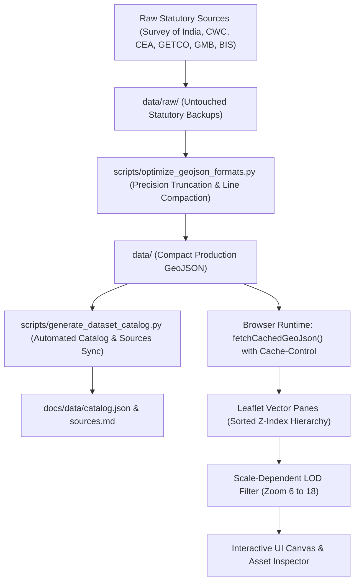

# Gujarat InfraMap — Geospatial Data Flow & LOD Engineering

## 1. Geospatial Data Pipeline
Gujarat InfraMap manages **3,327 features across 13 statutory GeoJSON datasets**. The data flow follows a strict unidirectional architecture:

---

## 2. Dataset Ingestion & Caching Strategy
To maintain instantaneous map loading times and zero memory thrashing:
1. **Asynchronous Cached Streaming:**
   The client uses `fetchCachedGeoJson(url)` in `js/app.js`. Datasets are requested asynchronously; critical base layers (Districts, District HQs, Major Highways) load eagerly during initialization, while heavy thematic layers (e.g. detailed rail nodes, secondary stations) load upon category expansion or user activation.
2. **Compact Coordinate Precision:**
   All coordinate vertices are normalized to 5 decimal places (~1.1 meter accuracy), which is more than sufficient for regional and state-level engineering oversight while cutting coordinate payload sizes by over 50%.
3. **Single-Line Coordinate Streams:**
   Rather than multi-line pretty-printed coordinate arrays (which ballooned `gujarat_roads.geojson` to 63,591 lines), coordinate lists are serialized on single lines per feature. This reduced file lines by 99.9% while preserving 100% of topological features and coordinate nodes.

---

## 3. Scale-Dependent Level-of-Detail (LOD) Rules
To eliminate visual clutter at statewide zoom levels and maximize performance, layers implement zoom-gated rendering thresholds via `js/layer_manager.js`:

| Category / Layer | Min Zoom | Max Zoom | Statewide Display Mode (Zoom 6–8) | City / Asset Mode (Zoom 9+) |
| :--- | :---: | :---: | :--- | :--- |
| **District Boundaries** | 6 | 18 | Prominent dark boundary fills & high-contrast borders | Muted subtle reference casing |
| **National Expressways & NH** | 6 | 18 | Expressways (NE-1) & GQ Gold corridors emphasized | Detailed lanes and highway markers visible |
| **State Highways (SH)** | 9 | 18 | Hidden to prevent line collision | Full geometry and state corridor numbers visible |
| **Major Railway Junctions** | 7 | 18 | Class A1/A Western Railway Hubs visible | All intermediate stations and halts revealed |
| **Minor Railway Stations** | 10 | 18 | Hidden | Full station points with passenger codes revealed |
| **Major CWC Dams** | 6 | 18 | Visible with high-priority hydrostatic markers | Detailed reservoir bathymetry polygons revealed |
| **Commercial Seaports & Airports** | 6 | 18 | High-priority maritime & aviation gateway icons | Berths, drafts, runways & terminal specs revealed |
| **GETCO 400kV/220kV Lines** | 8 | 18 | Hidden to maintain cartographic clarity | High-voltage transmission lines & substation nodes revealed |
| **Bedrock Geology & Faults** | 7 | 18 | Regional tectonic fault traces visible | Detailed lithological formation polygons revealed |
| **Soil Engineering Vertisols** | 8 | 18 | Hidden | NBSS&LUP soil series & expansiveness zones visible |

---

## 4. Feature Traversal & Graph Matching
Infrastructure assets in Gujarat InfraMap maintain relational graph connections:
- Dams link to their host river, downstream reservoirs, and Narmada Main Canal branch off-takes.
- Seaports link to Dedicated Freight Corridor (WDFC) feeder lines and National Highway logistics spurs.
- Power stations link to GETCO pooling substations and grid transmission voltages.
- Asset Inspector automatically traverses `connected_structures` or spatial proximity matrices to reveal connected nodes under the **Network** tab.
